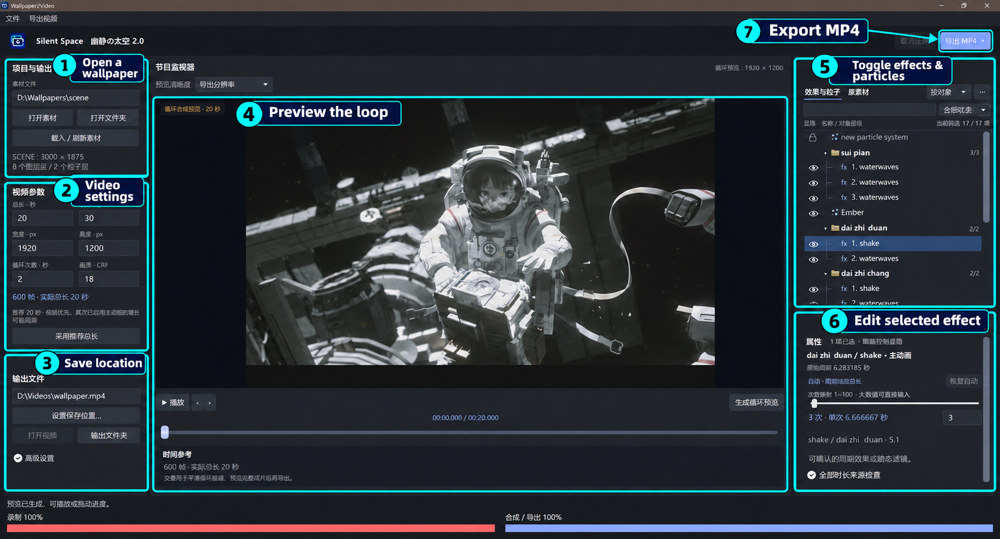

<p align="center">
  
</p>

<h1 align="center">Wallpaper2Video</h1>

<p align="center"><strong>Bring Wallpaper Engine wallpapers to your TV.</strong></p>

<p align="center">
  Export a looping MP4 on Windows, then set it as your TV home screen wallpaper with Aerial.
</p>

<p align="center">
  <a href="README.md">简体中文</a> · <strong>English</strong> ·
  <a href="../../releases">Download for Windows</a> ·
  <a href="#quick-start">Quick start</a> ·
  <a href="https://github.com/pengchujin/aerial-tv/blob/main/README.en.md">Install Aerial</a>
</p>

<p align="center">
  
</p>

## Find your way around

The screenshot shows a Scene wallpaper with image effects and particles. Click an effect's name to inspect its settings, or its eye icon to toggle visibility.

| Label | What it does |
| --- | --- |
| 1 Open a wallpaper | Load a wallpaper folder or video and inspect its type and layer count. |
| 2 Video settings | Set duration, frame rate, resolution, loop overlap and quality. |
| 3 Save location | Choose the MP4 path and open the finished video or its folder. |
| 4 Preview the loop | Generate and play the preview, or scrub the timeline to check the end-to-start transition. |
| 5 Toggle effects & particles | Search and select effects, particles or source layers. Use eye icons to toggle visibility. |
| 6 Edit selected effect | Adjust cycle counts or the emission window for supported particles. |
| 7 Export MP4 | Record, encode and save the video with the current settings. Progress appears along the bottom. |

## Quick start

1. **Download the app.** Get `Wallpaper2Video-win-x64-with-ffmpeg.zip` from [GitHub Releases](../../releases) and extract it on Windows 11 x64. This ZIP includes FFmpeg and FFprobe.
2. **Open a wallpaper.** Launch Wallpaper Engine from Steam before recording a Scene wallpaper. Double-click `Wallpaper2Video.Desktop.exe` and open your wallpaper folder or video.
3. **Preview and export.** Try 1920 × 1080 at 30 fps. Click **Generate Loop Preview** (生成循环预览), check the transition, then click **Export MP4** (导出 MP4).
4. **Set your TV wallpaper.** In Aerial on the TV, open **Control Center → Personalize**. Scan the QR code with your phone or open its URL on a PC on the same network. Add your MP4 under **My videos**, then select it under **Wallpaper** on the TV. [Aerial setup and other TV options](docs/README.md#tv-playback-en)

The standard `Wallpaper2Video-win-x64.zip` works with an existing FFmpeg installation. You can also extract the [full Windows build of FFmpeg](https://www.gyan.dev/ffmpeg/builds/ffmpeg-release-full.7z) and place `ffmpeg.exe` and `ffprobe.exe` from its `bin` folder next to the desktop app.

Both ZIPs include the **.NET 10 Desktop Runtime**. For a framework-dependent build, install the [Windows x64 Desktop Runtime](https://dotnet.microsoft.com/en-us/download/dotnet/10.0).

Supports Wallpaper Engine **Scene wallpapers** and video files. Web wallpapers are currently unsupported. Output is a silent H.264 MP4.

Video tutorial: [English subtitles](https://github.com/mczhang20168/wallpaper2video/releases/download/v1.0.0/Wallpaper2Video-tutorial-en.mp4) · [中文字幕](https://github.com/mczhang20168/wallpaper2video/releases/download/v1.0.0/Wallpaper2Video-tutorial-zh-CN.mp4)

## Build from source

Install the [.NET SDK specified in global.json](csharp/global.json) and run these commands from the repository root.

```powershell
.\csharp\build.ps1
.\csharp\src\Wallpaper2Video.Desktop\bin\Release\net10.0-windows\Wallpaper2Video.Desktop.exe
```

[CLI and packaging guide (Chinese)](csharp/README.md) · [Contributing (Chinese)](CONTRIBUTING.md) · [MIT License](LICENSE)

The bundled FFmpeg version, license and source are in [third_party/ffmpeg](third_party/ffmpeg/README.md).
