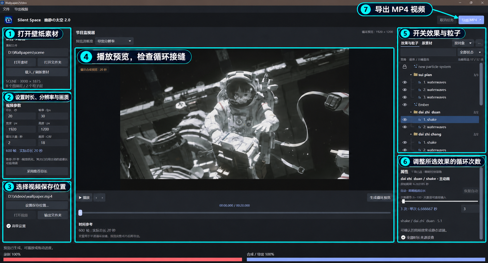

<p align="center">
  
</p>

<h1 align="center">Wallpaper2Video</h1>

<p align="center"><strong>让电视也能播放 Wallpaper Engine 壁纸。</strong></p>

<p align="center">
  在 Windows 上把动态壁纸转成循环 MP4，再用 Aerial 等电视桌面应用设为动态桌面壁纸。
</p>

<p align="center">
  <strong>简体中文</strong> · <a href="README.en.md">English</a> ·
  <a href="../../releases">下载 Windows 版</a> ·
  <a href="#快速开始">快速开始</a> ·
  <a href="https://github.com/pengchujin/aerial-tv#安装">安装 Aerial</a>
</p>

<p align="center">
  
</p>

## 界面怎么看

图中展示了带图像效果和粒子的 Scene 壁纸。右侧点击效果名称查看参数，点击眼睛切换显隐。

| 图中区域 | 可以做什么 |
| --- | --- |
| 1 打开壁纸素材 | 打开壁纸目录或视频，载入素材并查看类型和图层数量。 |
| 2 视频参数 | 设置总长、帧率、分辨率、循环交叠和画质。 |
| 3 保存位置 | 选择 MP4 的保存位置，导出后打开视频或所在文件夹。 |
| 4 循环预览 | 生成预览后播放或拖动时间轴，检查末尾切回开头的接缝。 |
| 5 效果与粒子 | 搜索并选择效果、粒子或原素材图层，用眼睛图标切换显隐。 |
| 6 所选效果属性 | 调整当前效果的循环次数，选择可定时的粒子时，可设置发射时段。 |
| 7 导出视频 | 按当前参数录制、合成并保存 MP4。底部显示任务进度。 |

## 快速开始

1. **下载程序。** 从 [GitHub Releases](../../releases) 下载推荐的 `Wallpaper2Video-win-x64-with-ffmpeg.zip`，在 Windows 11 x64 上解压。包内已放好 FFmpeg 和 FFprobe。
2. **打开壁纸。** 录制 Scene 壁纸前，先在 Steam 启动 Wallpaper Engine。双击 `Wallpaper2Video.Desktop.exe`，打开壁纸文件夹或视频。
3. **预览并导出。** 电视上可以先试 `1920 × 1080`、`30 fps`。点击「生成循环预览」，确认接缝后点击「导出 MP4」。
4. **设为电视壁纸。** 如使用 Aerial 电视桌面，则打开「控制中心 → 个性化」。手机扫码，或在同一局域网的电脑打开二维码网址。到网页「我的视频」添加 MP4，再到电视端「壁纸」选中它。 [详细步骤与其他电视端选项](docs/README.md#tv-playback)

标准版 `Wallpaper2Video-win-x64.zip` 适合已有 FFmpeg 的用户。也可以下载并解压 [FFmpeg Windows 完整版](https://www.gyan.dev/ffmpeg/builds/ffmpeg-release-full.7z)，把 `bin` 中的 `ffmpeg.exe`、`ffprobe.exe` 放到桌面程序旁。

两个 ZIP 都含 **.NET 10 桌面运行时**。使用框架依赖版时，先安装 [Microsoft .NET 10 Desktop Runtime（Windows x64）](https://dotnet.microsoft.com/zh-cn/download/dotnet/10.0)。

支持 Wallpaper Engine **Scene 壁纸**和视频，Web 壁纸暂不支持。输出为静音 H.264 MP4。 [工作原理](docs/README.md)

教学视频：[中文字幕](https://github.com/mczhang20168/wallpaper2video/releases/download/v1.0.0/Wallpaper2Video-tutorial-zh-CN.mp4) · [English subtitles](https://github.com/mczhang20168/wallpaper2video/releases/download/v1.0.0/Wallpaper2Video-tutorial-en.mp4)

## 从源码构建

安装 [global.json](csharp/global.json) 指定的 .NET SDK，在项目根目录运行以下命令。

```powershell
.\csharp\build.ps1
.\csharp\src\Wallpaper2Video.Desktop\bin\Release\net10.0-windows\Wallpaper2Video.Desktop.exe
```

[命令行与打包说明](csharp/README.md) · [贡献指南](CONTRIBUTING.md) · [MIT 许可证](LICENSE)

自带版中 FFmpeg 的版本、许可和源码保存在 [third_party/ffmpeg](third_party/ffmpeg/README.md)。
